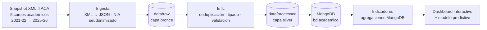

# Proyecto 1 · Analítica académica ITACA (origen XML)


Pipeline de datos end-to-end que extrae, procesa y analiza datos académicos de la plataforma **ITACA** (exportación en **XML**) para su posterior visualización en un **dashboard interactivo**.

---

## 📋 Descripción y objetivo

Este proyecto tiene como objetivo extraer y procesar datos académicos procedentes de la plataforma **ITACA**, utilizando archivos **XML** como fuente de datos.

Los datos corresponden a diferentes aspectos del ámbito académico, como:

- **Alumnos**
- **Contenidos**
- **Calificaciones**
- **Cursos**

El proyecto transforma estos datos mediante un proceso de **ingesta, almacenamiento, limpieza y procesamiento**, con el objetivo de generar información útil para su posterior análisis.

Finalmente, los datos procesados se utilizarán para crear un **dashboard interactivo** que permita visualizar indicadores académicos y facilitar el análisis del rendimiento de los alumnos.

## 🏗️ Arquitectura



El almacenamiento se organiza en capas tipo *medallion*: los ficheros de origen se procesan hacia `data/raw` (bronce), el ETL genera el dataset limpio (`data/processed`, *silver*) y se reserva `data/gold` para los agregados y KPIs del dashboard.

## 🧰 Stack tecnológico

| Herramienta          | Uso en el proyecto                                        |
|----------------------|-----------------------------------------------------------|
| **Python 3.11+**     | Lenguaje principal del pipeline                           |
| `xml.etree`          | Parseo de los ficheros XML de origen                      |
| **Pandas**           | Limpieza, tipado y validación de datos (ETL)              |
| **PyMongo**          | Carga y consultas sobre MongoDB                           |
| **MongoDB 7**        | Almacenamiento de las colecciones académicas              |
| **Mongo Express**    | Interfaz web de administración de la base de datos        |
| **Docker Compose**   | Orquestación de la infraestructura de almacenamiento      |
| `hashlib` (SHA-256)  | Seudonimización del NIA en la ingesta                     |
| `requests` + `.env`  | Ingesta vía API (módulo de prácticas, AEMET)              |

## 📁 Estructura del proyecto

```text
bigdata-p1-itaca/
├── Analisis_Academico/            # Snapshot XML de origen (un directorio por curso académico)
│   ├── 2021-22/ … 2025-26/
│   │   ├── alumnos.xml
│   │   ├── calificaciones.xml
│   │   ├── contenidos.xml
│   │   ├── cursos.xml
│   │   └── grupos.xml             # Exportado, pero aún no incorporado a la ingesta
├── data/
│   ├── Analisis_Academico/        # Copia del snapshot usada por el prototipo inicial
│   ├── raw/                       # Capa bronce: JSON de ingesta, por año y tabla
│   ├── silver/                    # Capa silver: datos limpios (en desarrollo)
│   └── gold/                      # Capa gold: KPIs y agregados para el dashboard (pendiente)
├── ingesta/
│   ├── ingesta_itaca_xml.py       # Ingesta principal: XML → JSON
│   └── ingesta_api.py             # Práctica de ingesta vía API (AEMET)
├── etl/
│   └── etl_itaca.py               # Limpieza, validación y carga en MongoDB
├── dashboard/                     # Visualización (pendiente)
├── indicador_suspensos.py         # Indicador de ejemplo (pipeline de agregación MongoDB)
├── ingestar_itaca_xml.py          # Prototipo inicial de la ingesta
├── docker-compose.yml             # MongoDB 7 + Mongo Express
├── .env                           # Variables de entorno (credenciales de APIs)
└── README.md
```

## 🗂️ Fuentes de datos

Los datos de origen proceden de la plataforma **ITACA** y se entregan mediante **exportación en formato XML**. El mecanismo de acceso consiste en descargar el archivo comprimido **`Datos Análisis Académico XML`**, que contiene un subdirectorio por curso académico con un archivo XML en su interior para cada una de las tablas del modelo relacional de origen utilizadas en este proyecto: **Alumnos**, **Contenidos**, **Calificaciones** y **Cursos**.

La exportación constituye un *snapshot* puntual del sistema académico: los archivos XML se descargan y se incorporan directamente al proceso de **ingesta**, sin conexión adicional a la base de datos relacional de origen. En este repositorio se incluyen los snapshots de los cursos **2021-22 a 2025-26**.

A continuación se documentan, para cada tabla, el mecanismo de acceso, los campos disponibles y la frecuencia de actualización esperada.

### Alumnos

- **Mecanismo de acceso:** fichero XML correspondiente a la tabla `Alumnos`, incluido en el ZIP `Datos Análisis Académico XML`.
- **Frecuencia de actualización esperada:** anual, con la matriculación del curso académico (con posibles regeneraciones puntuales por altas, bajas o cambios de grupo).

| Campo   | Tipo   | Descripción                     |
|---------|--------|---------------------------------|
| Anyo    | string | Año académico                   |
| NIA     | int    | Número de Identificación Alumno |
| Curso   | string | Curso al que pertenece          |
| PrimSeg | string | Primaria o Secundaria           |
| Ciclo   | string | Ciclo formativo                 |
| Grado   | string | Grado académico                 |
| Familia | string | Familia profesional             |
| Turno   | string | Turno (mañana, tarde, etc.)     |
| Grupo   | string | Grupo al que pertenece          |

### Contenidos

- **Mecanismo de acceso:** fichero XML correspondiente a la tabla `Contenidos`, incluido en el ZIP `Datos Análisis Académico XML`.
- **Frecuencia de actualización esperada:** anual, al inicio del curso académico, cuando cambia la oferta de módulos.

| Campo         | Tipo   | Descripción            |
|---------------|--------|------------------------|
| Anyo          | string | Año académico          |
| Curso         | string | Curso al que pertenece |
| Modulo        | string | Código del módulo      |
| Nombre_Modulo | string | Nombre del módulo      |

### Calificaciones

- **Mecanismo de acceso:** fichero XML correspondiente a la tabla `Calificaciones`, incluido en el ZIP `Datos Análisis Académico XML`.
- **Frecuencia de actualización esperada:** varias veces por curso académico, tras cada corte de evaluación (una exportación por evaluación cerrada).

| Campo      | Tipo   | Descripción                     |
|------------|--------|---------------------------------|
| Anyo       | string | Año académico                   |
| NIA        | int    | Número de Identificación Alumno |
| Curso      | string | Curso al que pertenece          |
| Modulo     | string | Código del módulo               |
| Nota       | float  | Nota obtenida                   |
| Evaluacion | string | Evaluación correspondiente      |

### Cursos

- **Mecanismo de acceso:** fichero XML correspondiente a la tabla `Cursos`, incluido en el ZIP `Datos Análisis Académico XML`.
- **Frecuencia de actualización esperada:** anual o bajo demanda, según cambios en la estructura académica (jerarquía de cursos).

| Campo      | Tipo   | Descripción                        |
|------------|--------|------------------------------------|
| Anyo       | string | Año académico                      |
| Codigo     | string | Código del curso                   |
| Nombre_Cas | string | Nombre del curso en castellano     |
| Nombre_Val | string | Nombre del curso en valenciano     |
| Padre      | string | Código del curso padre (jerarquía) |

#### Correspondencia XML → modelo de datos

Los atributos del XML se mapean sobre el modelo de datos durante la ingesta:

| Tabla          | Atributo en XML                                          | Campo del modelo                    |
|----------------|----------------------------------------------------------|-------------------------------------|
| `alumnos`      | `NIA` · `curso` · `turno` · `grupo`                      | NIA · Curso · Turno · Grupo         |
| `cursos`       | `codigo` · `nombre_cas` · `nombre_val` · `padre`         | Codigo · Nombre_Cas · Nombre_Val · Padre |
| `calificaciones` | `alumno` · `curso` · `contenido` · `nota_numerica` · `evaluacion` | NIA · Curso · Modulo · Nota · Evaluacion |
| `contenidos`   | `curso` · `codigo` · `nombre_cas`                        | Curso · Modulo · Nombre_Modulo      |

> **Notas sobre la exportación:**
> - El **año académico** no viene en cada registro: la ingesta lo toma del snapshot (directorio `AAAA-BB`) y lo añade como campo `Anyo`.
> - Los campos `PrimSeg`, `Ciclo`, `Grado` y `Familia` del modelo de `Alumnos` no aparecen en la exportación y quedan vacíos.
> - La exportación incluye además `grupos.xml`, cuya incorporación al pipeline queda pendiente.
> - Al publicarse una nueva versión de la exportación, la ingesta deberá procesar de nuevo el ZIP completo, ya que los cuatro XML forman parte del mismo snapshot del sistema origen.

## 🔁 Pipeline de datos

### 1. Ingesta — `ingesta/ingesta_itaca_xml.py`

- Recorre los snapshots de `Analisis_Academico/{año}/` y parsea los cuatro XML de cada curso académico.
- Extrae únicamente los **campos académicos** del modelo, descartando los atributos personales del XML.
- **Seudonimiza el NIA** con SHA-256 (10 primeros caracteres): transformación determinista que permite cruzar tablas y años sin exponer el identificador real.
- Escribe el resultado como JSON en `data/raw/{año}/{tabla}_{fecha}.json`.

### 2. Limpieza y validación (ETL) — `etl/etl_itaca.py`

- Selecciona el JSON **más reciente** de cada tabla y año en `data/raw/`.
- Aplicación de reglas de calidad:
  - Eliminación de **duplicados exactos**.
  - Recorte de espacios en textos; cadenas vacías → nulo.
  - `Nota` → numérico válido en **[0, 10]** (fuera de rango o no numérico → nulo, con log de aviso).
  - Códigos (`Curso`, `Modulo`, `Codigo`, `Padre`, `NIA`) siempre como **texto**, para no perder ceros a la izquierda.
- Guarda el dataset limpio en `data/processed/{año}/{tabla}_limpio.json` (capa *silver*).

### 3. Carga en almacenamiento — `etl/etl_itaca.py`

- Vuelca todas las colecciones limpias a **MongoDB** (base de datos `academico`), recreando cada colección en cada ejecución (*full refresh*).
- Requiere la infraestructura levantada previamente con Docker Compose.

### 4. Consumo y análisis

- `indicador_suspensos.py`: ejemplo de indicador mediante un **pipeline de agregación** de MongoDB (`$match` → `$group` → `$sort`) que calcula el **número de suspensos por módulo** en la 1.ª evaluación.
- Los indicadores servirán de base para el **dashboard interactivo** y el **modelo predictivo** previstos en las siguientes fases.

## 🔒 Privacidad y tratamiento de datos

- El **NIA se seudonimiza** en la ingesta (SHA-256 truncado, determinista), de forma que los datos en MongoDB no exponen el identificador real del alumno.
- La ingesta **descarta los atributos personales** presentes en el XML (nombre, apellidos, documento, teléfonos, correos, fechas de nacimiento…), conservando solo los campos académicos.
- Los ficheros de origen se distribuyen ya con valores personales ficticios; aún así, el pipeline aplica minimización de datos por diseño.

## 🚀 Puesta en marcha

### Requisitos

- **Python 3.11+**
- **Docker** y **Docker Compose**

### 1. Clonar el repositorio y crear el entorno

```powershell
git clone <url-del-repositorio>
cd bigdata-p1-itaca

python -m venv .venv
.venv\Scripts\Activate.ps1        # Windows PowerShell
# source .venv/bin/activate       # Linux / macOS

pip install pandas pymongo requests python-dotenv
```

> En Linux/macOS, activa el entorno con `source .venv/bin/activate`.

### 2. Levantar la infraestructura

```powershell
docker compose up -d
```

Esto arranca:

| Servicio        | Puerto | Descripción                                |
|-----------------|--------|--------------------------------------------|
| `bigdata-mongo` | 27017  | MongoDB 7                                  |
| `mongo-express` | 8081   | UI web: <http://localhost:8081> (`admin`/`admin`) |

> Las credenciales y puertos de MongoDB se definen en `docker-compose.yml`; deben coincidir con los parámetros de conexión de los scripts.

### 3. Ejecutar el pipeline

```powershell
python ingesta\ingesta_itaca_xml.py   # 1) Ingesta XML → data/raw
python etl\etl_itaca.py               # 2) Limpieza + carga en MongoDB
python indicador_suspensos.py         # 3) Indicador de ejemplo
```

## 📊 Estado del proyecto

- [x] Ingesta XML → JSON con seudonimización de NIA (5 cursos académicos)
- [x] Limpieza y validación con Pandas (deduplicación, tipado, rangos)
- [x] Infraestructura MongoDB 7 + Mongo Express vía Docker Compose
- [x] Carga de colecciones en MongoDB
- [x] Indicador de ejemplo (suspensos por módulo, 1.ª evaluación)
- [ ] Incorporación de `grupos.xml` al pipeline
- [ ] Capa *gold*: agregados y KPIs
- [ ] Dashboard interactivo
- [ ] Modelo predictivo
- [ ] Formalizar `requirements.txt`

---

*Proyecto formativo de Big Data — analítica académica sobre la plataforma ITACA.*
